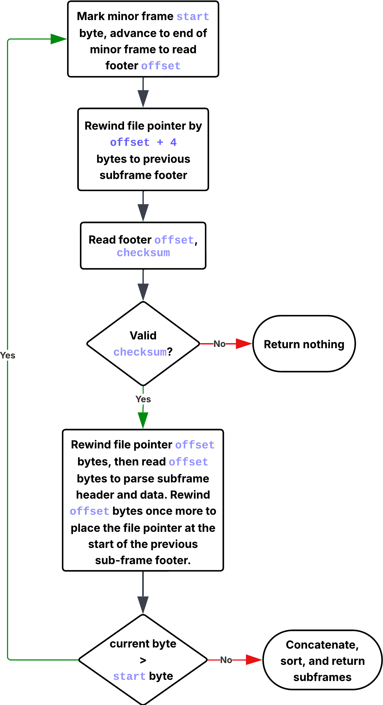

Much of my work in my current post-doc (and all through graduate school) has me working with Campbell Scientific equipment and data loggers. We use them pretty much everywhere, and they're the industry standard for building micrometeorology and eddy covariance platforms. Their dataloggers output data using a proprietary binary format called "Table Oriented Binary," or "TOB." This format is compact and robust to data corruption, but documentation about it is sparse, and the tooling provided by Campbell Scientific (with CardConvert, tob32.exe, and CSIDFT_convert.exe) to convert it to ASCII is rather obtuse. In this post, I'll try to break down the TOB1, TOB2, and TOB3 formats as thoroughly as I can, and I'll share a python program I wrote to convert TOB files to ASCII format that is much faster than the tools provided by Campbell Scientific, is free and open source, and which can be easily integrated into automatic data processing pipelines.

In this post I’ll do two things:

- Give a practical breakdown of **TOB1**, **TOB2**, and **TOB3** and provide examples of how to parse them.
- Share the approach behind my Python package **camp2ascii**, which converts TOB files to ASCII.

## TOB files overview
TOB files are binary, so they’re typically much smaller than ASCII exports (often ~2–3x smaller, YMMV). There are three variants: **TOB1**, **TOB2**, and **TOB3**. TOB1 is the simplest format and is compatible with some external programs, TOB3 is the most common that I've seen, and TOB2 is a less common and less useful alternative to TOB3.

All three share the same high-level structure:

- A multi-line **ASCII header** (comma-separated values) that describes the logger and file metadata.
- A **binary payload** that starts immediately after the header, where values are encoded in a compact, machine-readable format.

There’s no explicit row delimiter in the binary payload. To decode it, you have to compute record/frame boundaries from the header metadata (column data types, frame sizes, etc.). This differs from typical CSV or plaintext files, where values are separated by commas or another delimeter, rows are separated by newline characters, and values are written in human-readable plaintext.

The main difference between the TOB file formats is how the binary payload is organized:

- **TOB1**: a stream of fixed-length **records** (each record = one timepoint).
- **TOB2/TOB3**: a stream of fixed-length **frames**. Each frame contains a header, 0 or more records, and a footer. Each frame contains the same number of records, usually about ~10, but this can vary based on the datalogger program.

## TOB1 files
Campbell suggests that you use TOB1 files if you want external programs (such as EddyPro) to be able to read the files, as they are much simpler than TOB2 and TOB3 files and the documentation for parsing them is more readily available than for TOB2/3. However, they are not quite as compact as a TOB2 or TOB3 file, and are slightly more vulnerable to corruption.

[Here is the documentation page for TOB1 files from Campbell Scientific](https://help.campbellsci.com/loggernet-manual/ln_manual/campbell_scientific_file_formats/tob1.htm), but I’ll reorganize it here and add a few practical notes.

### ASCII header
The file begins with an ASCII (plain-text) header that contains metadata about the file and the datalogger that created it. The header is always 5 lines long, and each line is a comma-separated list of values. 
#### Line 1
```
"TOB1","<logger name>","<logger model>","<logger sn>","<logger OS>","<program name>","<program signature>","<table name>"
```
This line is fairly self-explanatory: this is all just information about the datalogger itself

* `TOB1`: the file format
* `<logger name>`: the name of the datalogger, which is set by the user in the datalogger's settings
* `<logger model>`: the model of the datalogger, such as "CR1000" or "CR3000"
* `<logger sn>`: the serial number of the datalogger
* `<logger OS>`: the operating system of the datalogger, such as "CR1000X.Std.08.01"
* `<program name>`: the name of the program running on the datalogger
* `<program signature>`: a hash of the program running on the datalogger, which provides a way to verify that the program running on the datalogger is the same as the one used to generate the data.
* `<table name>`: the name of the table being stored in the file, which is set by the user in the datalogger program.

#### Line 2
```
"SECONDS","NANOSECONDS","RECORD","<column name>",...\n
```
This line lists the names of the columns in the binary table.

In many TOB1 files you’ll see the three “index” fields first: `SECONDS`, `NANOSECONDS`, and `RECORD`. Campbell’s docs note that these are *optional outputs* in TOB1: if present, the header line will include them. (There really is no reason to not include these when setting up the table output using `TableFile` in CRBasic).

The "RECORD" column is a counter that increments by 1 for each datapoint, and serves as a unique identifier for each datapoint. The "SECONDS" and "NANOSECONDS" columns together provide a timestamp for each record, split into integer seconds plus a nanosecond offset within that second. The timestamp cannot provide a realiable index on the data, since clock drifts and changes can cause the timestamp to jump around or repeat.

The "SECONDS" field gives the number of seconds elapsed since the Campbell epoch, **1990-01-01** (same convention you’ll see when decoding TOB2/3 frame headers), which means you add `631_152_000` seconds to convert to Unix a timestamp:

```python
timestamp_unix_ns = (seconds + 631_152_000)*1_000_000_000 + nanoseconds
```

In the above example, working with integers and nanoseconds helps to avoid precision issues that can arise if you try to convert to floating-point seconds.

#### Line 3
```
"","","RN","<column unit>",...\n
```
This provides the units for each column. The SECONDS and NANOSECONDS columns have no units, and the RECORD column has the unit "RN" (record number). The remaining columns have units that are set by the user in the datalogger program.

#### Line 4

```
"","","","<column processing>",...\n
```
This contains information about how each column is processed by the datalogger. The index columns (SECONDS, NANOSECONDS, and RECORD) have no processing, and the remaining columns have processing information that is set by the user in the datalogger program:

| Data processing name	| Abbreviation |
|-----------------------|-------------|
| Totalize              | Tot         |
| Average               | Avg         |
| Maximum               | Max         |
| Minimum               | Min         |
| Sample at Max or Min  | SMM         |
| Standard Deviation     | Std         |
| Moment                 | MMT         |
| Sample                 | Smp or Nothing |
| Histogram              | Hst         |
| Histogram4D            | H4D         |
| FFT                    | FFT         |
| Covariance             | Cov         |
| Level Crossing         | LCr         |
| WindVector             | WVc         |
| Median                 | Med         |
| ET                     | ETsz        |
| Solar Radiation (from ET) | RSo      |
| Time of Max            | TMx         |
| Time of Min            | TMn        |

#### Line 5

```
"ULONG","ULONG","ULONG","<column data type>",...\n
```

These give the data types of each column in the binary data table. The SECONDS, NANOSECONDS, and RECORD columns are always unsigned long integers (ULONG), and the remaining columns have data types that are set by the user in the datalogger program. All the datatypes I've been able to track down are outlined lower down in this article.

### Data table
After the newline character at the end of the last ASCII header line, the binary payload starts. Each datapoint is a fixed-length binary word consisting of the binary encodings of each field in that row. 

For example, if the data table consists of 5 columns:

| Column Name | Data Type |
|-------------|-----------|
| SECONDS     | ULONG (4 bytes)     |
| NANOSECONDS  | ULONG (4 bytes)     |
| RECORD      | ULONG (4 bytes)     |
| temperature  | FP2 (2 bytes)       |
| humidity     | FP2 (2 bytes)       |

then each datapoint will consist of the binary encoding of three unsigned long integers followed by the binary encoding of two FP2 floating-point numbers. To read the first datapoint, you would read 4 bytes for seconds, 4 bytes for nanoseconds, 4 bytes for record, 2 bytes for temperature, and 2 bytes for humidity, for a total of 16 bytes per datapoint. The next byte would be the start of the second datapoint, and so on, until you reached the end of the file.

## TOB2 and TOB3 files
TOB2 and TOB3 files store data in "frames" consisting of several datapoints each, delineated with a frame header and frame footer. A single binary payload in a TOB2/3 file will contain multiple frames, each consisting of about ~10 datapoints. Each frame has its own binary-encoded header that identifies the starting timestamp of that frame, and the binary data for that frame follows immediately after the frame header. Each frame terminates with a footer that provides a checksum to verify the frame validity, as well as some metadata about the structure of the frame itself.

You can read the official documentation for TOB2 and TOB3 files [here](https://help.campbellsci.com/loggernet-manual/ln_manual/campbell_scientific_file_formats/tob2_or_tob3.htm)

### ASCII header
#### Line 1
Similar to TOB1 files, but with a couple changes:

```
<file format>,"<logger name>","<logger model>","<logger sn>","<logger OS>","<program name>","<program signature>","<file created time>"\n
```
* `<file format>`: the file format, which is either "TOB2" or "TOB3"
* `<file created time>`: the time that the file was created, in the format "YYYY-MM-DD HH:MM:SS"

#### Line 2
```
"<table name>","<record interval>","<frame size>","<table size>","<validation stamp>","<frame time resolution>","<ring record?>","<card removal?>","<???>"\n
```

* `<table name>`: the name of the table being stored in the file, which is set by the user in the datalogger program.
* `<record interval>`: the time interval between records within a frame, formatted as a number followed by a unit, such as "300 SEC" or "5 MIN"
* `<frame size>`: the size of each frame in bytes, including the header, binary data, and footer. This is set automatically by the datalogger, and in my experience is usually around ~1000 bytes.
* `<validation stamp>`: a per-frame validation value used to check frame integrity (more on this in the footer section).
* `<frame time resolution>`: the timestamp tick size used in frame headers (e.g. 1 ms, 100 µs, 10 µs, 1 µs).

About the `table size`, `ring record?`, `card removal?`, and `???` fields: I'm sure these have some use in real-world files, but they’re not described in any useful detail in the documentation that I could find. In my code I ignore them. My best guess is that `table_size` provides the total number of dataframes expected in that file, `ring record?` indicates whether the file is a "ring memory" file (a special type of file that is continuously overwritten in a circular buffer on the datalogger's SD card, which can be useful for debugging but is not commonly used for actual data collection), and `card removal?` indicates whether the SD card was removed during the writing of that frame. I have no idea what the `???` field might be for.

#### Lines 3–6
These correspond to TOB1 header lines 2–5:

- Line 3: field names
- Line 4: units
- Line 5: processing
- Line 6: data types

### Data table
The data table starts immediately following the ASCII header, and is composed of multiple frames, each `frame size` bytes in length. Each frame consists of a header, binary data, and a footer. 

#### Frame header
The frame header is 12 bytes long in TOB3 and contains the timestamp of the first datapoint in that frame (8 bytes) followed by the record number (4 bytes). In TOB2 files, the frame header is 8 bytes long and does not include the record number.

The frame header is encoded as follows:
1. Seconds since the Campbell epoch (1990-01-01)  of the first datapoint in the frame (4 bytes, unsigned long integer, little-endian). 
2. Subseconds tick count of the first datapoint in the frame (4 bytes, unsigned long integer, little-endian). Interpret this as "number of ticks" at the `frame time resolution`.
3. Record number of the first datapoint in the frame (4 bytes, unsigned long integer, little-endian) (TOB3 only)

To compute the timestamp of the first datapoint in the frame in nanoseconds since the Unix epoch, you can use the following (integer) formula:
```
campbell_epoch_s = 631_152_000
frame_time_resolution_ns = int(frame_time_resolution_s * 1_000_000_000)
frame_start_unix_timestamp_ns = (seconds + campbell_epoch_s)*1_000_000_000 + subseconds*frame_time_resolution_ns
```

The record numbers of the datapoints in the frame count up by 1 for each datapoint after the first one in the frame, and the timestamp of each datapoint can be computed by adding the `record interval` to the timestamp of the first datapoint. For example, if the `record interval` is `"300 SEC"`, then the timestamp of the second datapoint in the frame would be `frame_start_unix_timestamp_ns + 300*1_000_000_000`.

#### Frame data
The frame data consists of the binary encodings of each datapoint in that frame, stored sequentially. The data types of each column are given in the last header line, as with TOB1.

The number of bytes available for records inside each frame is:

- TOB3: `frame size - 12 (frame header) - 4 (footer)`
- TOB2: `frame size - 8 (frame header) - 4 (footer)`

#### Frame footer
Unfortunately, I couldn't find any (well-publicized) documentation on how to decode frame footer, so I had to rely on the code written by Mathias Bavay for the version of `camp2ascii` that he wrote ([link](https://gitlabext.wsl.ch/bavay/camp2ascii)). The frame footer is a 4 byte unsigned little-endian integer that provides a checksum value, plus some flags and other metadata about the frame. Extract the flags from the resulting integer using the following bit masks:

1. Offset: bits 0-10 (`footer & 0x7FF`): More on this later, in the section on minor frames.
2. File mark flag: bit 11 (`(footer >> 11) & 0x1`): This field probably indicates when SD card was removed, or something similar to that. I haven't had to deal with it in my code to get accurate results, so I ignore it.
3. Ring mark flag: bit 12 (`(footer >> 12) & 0x1`): Again, I ignore this field. It probably indicates the last frame written chronologically when the datalogger is writing in "ring-memory" mode.
4. Empty frame flag: bit 13 (`(footer >> 13) & 0x1`): I ignore this field.
5. Minor frame flag: bit 14 (`(footer >> 14) & 0x1`): indicates if the frame is a "minor" or "major" frame. Minor frames require special processing (more on this later).
6. Checksum: bits 16-31 (`(footer >> 16) & 0xFFFF`): should match the `validation stamp` in the ASCII header. Sometimes the checksum value is off by 1 from the `validation stamp` even when the frame contains valid data (I don’t know why; I allow ±1 in my parser).

#### Minor frames
This was an endless source of frustration for me until I figured it out...some dataframes have valid checksum values but still appear corrupted. These are minor frames, and need to be handled in a special way. Minor frames are frames that have been cut short and had the extra space filled with garbage data. There's no official documentation about how to parse minor frames *anywhere* that I could find, so I had to reverse engineer it from the raw binary data. (Though this may be a common technique in binary files and I'm just not familiar with it...if you know more about this please let me know.) Since each frame has a fixed size with (normally) fixed time intervals between records, removing the SD card in the middle of a frame (resulting in garbage padding at the end) or changing the clock time mid-frame (leading to inconsistent time gaps between records) can corrupt that frame without wrecking the rest of the file. Minor frames are frames like this, where the corruption has been "contained" in a structured way that allows you to still recover the valid data from that frame, while skipping the garbage padding at the end.

The end of a minor frame consists of garbage padding followed by a footer with (a) the minor flag set and (b) a non-zero `offset`.

The `offset` tells you how many bytes *before the end of the frame* the last bit of valid data ends. If you rewind by `offset` bytes, you’ll land on another footer that marks the end of the valid portion of the frame (a “sub-frame”). That valid portion is `frame size - offset` bytes long and includes its own header, body, and footer.

Minor frames can also contain **multiple** sub-frames. If a sub-frame footer has a non-zero offset, that indicates another (earlier) sub-frame that ends `offset` bytes before the end of the current sub-frame. You can follow this chain until you reach a footer with `offset == 0`, which indicates the terminal sub-frame.

Below is a flow chart to help visualize the logic.

<div align="center">
  
</div>


## Data types
Campbell Scientific dataloggers support a variety of data types, some of which are proprietary. Below is a table summarizing the data types that can be found in TOB files, along with their descriptions, byte sizes, and endianness.

| Data Type | Description | Bytes | Endianness |
|-----------|-------------|-------|-----------|
| IEEE4 | IEEE-754 float32 | 4 | Little |
| IEEE4B | IEEE-754 float32 | 4 | Big |
| IEEE8 | IEEE-754 float64 | 8 | Little |
| IEEE8B | IEEE-754 float64 | 8 | Big |
| FP2 | Campbell 2-byte float, see note | 2 | Big |
| FP4 | Campbell 4-byte float, see note | 4 | Little |
| USHORT | Unsigned 16-bit int | 2 | Little |
| SHORT | Signed 16-bit int | 2 | Little |
| UINT2 | Unsigned 16-bit int | 2 | Big |
| INT2 | Signed 16-bit int | 2 | Big |
| UINT4 | Unsigned 32-bit int | 4 | Big |
| INT4 | Signed 32-bit int | 4 | Big |
| ULONG | Unsigned 32-bit int | 4 | Little |
| LONG | Signed 32-bit int | 4 | Little |
| NSEC | Campbell timestamp, see note | 8 | Big |
| SECNANO | Campbell timestamp, see note | 8 | Little |
| BOOL | Boolean flag, see note | 1 | N/A |
| BOOL8 | Boolean bitfield | 1 | N/A |
| BOOL4 | Boolean flag, see note | 4 | N/A |
| BOOL2 | Boolean flag, see note | 2 | N/A |
| ASCII(n) | ASCII string, see note | n | N/A |


### Notes
* FP2 and FP4 are proprietary floating-point formats used by Campbell Scientific dataloggers. The FP2 format offers greater precision within typical micrometeorological ranges than the standard IEEE-754 float16 format, likewise FP4 offers greater precision than IEEE-754 float32 in typical micrometeorological ranges. The python code to decode FP2 and FP4 formats is given below:

    ```python
    def decode_fp2(fp2: bytes) -> float:
        content = int.from_bytes(fp2, byteorder='big', signed=False)
        sign = (content >> 15) & 0x1
        exponent = (content >> 13) & 0x3
        mantissa = content & 0x1FFF
        result = ((-1.0) ** sign) * (10.0 ** (-exponent)) * mantissa
        # Campbell FP2 NaN encodings
        if (
            (exponent == 0 and mantissa == 8191) or 
            (sign == 1 and exponent == 0 and mantissa == 8190) or 
            (abs(result) >= 8191)
        ):
            return float('nan')
        return result

    def decode_fp4(fp4: bytes) -> float:
        # taken directly from Mathias Bavay's camp2ascii: "in progress... but it should work! see Appendix C of CR10X manual"
        content = int.from_bytes(fp4, byteorder='little', signed=False)
        sign = ((0x80000000 & content) >> 31)
        exponent = ((0x7F000000 & content) >> 24)
        mantissa = ((0x00FFFFFF & content))
        result = (-1)**sign * mantissa/16777216.0*(2.0**(exponent-64))
        if abs(result) > 99999:
            return float('nan')
        return result
    ```

* NSEC / SecNano: proprietary 8-byte timestamp formats you may see for certain processed time outputs (e.g. `TMx`, `TMn`) and in some tables. The following decodes a little-endian `SecNano` into nanoseconds since the Unix epoch:
    ```python
    def decode_secnano(secnano: bytes) -> int:
        content = int.from_bytes(secnano, byteorder='little', signed=False)
        campbell_epoch_s = 631_152_000  # seconds between Unix epoch and Campbell epoch (1990-01-01)
        seconds = (content & 0xFFFFFFFF) + campbell_epoch_s
        nanoseconds = content >> 32
        return seconds * 1_000_000_000 + nanoseconds
    ```

    `NSEC` is processed identically to `SecNano` but with big-endian byte order.
* BOOL, BOOL2, and BOOL4: in practice you’ll usually see `0x00` for false and `0xFF` for true (Campbell’s TOB1 docs explicitly note this for `BOOL`). Treating “nonzero = true” works fine for decoding.
* BOOL8 is a bitfield with 8 boolean flags packed into a single byte, where the least significant bit is the first flag.
* ASCII(n): fixed-length ascii strings that are null-terminated if the string is shorter than the fixed length, given by `n`.

## Pseudocode for parsing TOB files
This section contains pseudocode (in Python) for parsing TOB1, TOB2, and TOB3 files. The pseudocode is not meant to be a complete or optimized implementation, but rather a high-level overview of the logic of the file parsing process. The actual implementation of the `camp2ascii` tool that I wrote is available on [GitHub](https://github.com/alextsfox/camp2ascii), and is much more optimized.

### TOB1
```python
# Assuming the following ASCII header:
# "TOB1","MyLogger","CR1000X","8472","CR1000X.Std.04.02","CPU:test.cr1x","42580","Biomet"\n
# "SECONDS","NANOSECONDS","RECORD","temperature_Avg","temperature_TMx","date"\n
# "","","RN","degC","%"\n
# "","","","Avg","TMx","Smp"\n
# "ULONG","ULONG","ULONG","FP2","SecNano","ASCII(16)"\n

buffer = open_bytes("data_file.dat")

# Read and parse the ASCII header...not shown here
ascii_header = []
for i in range(5):
    line = buffer.readline().decode('ascii')
    ascii_header.append(line)
names, dtypes = parse_ascii_header(ascii_header)

# read the binary data line-by-line
columns = dict(
    "SECONDS": [],
    "NANOSECONDS": [],
    "RECORD": [],
    "temperature_Avg": [],
    "temperature_TMx": [],
    "date": [],
)
while buffer.tell() < file_size:
    for k, t in zip(names, dtypes):
         # get the data type abbreviation, such as "FP2" or "ASCII",
         #  without the parameters in parentheses, such as the "n" 
         # in "ASCII(n)"
        dtype_abbrev = t.split('(')[0].upper()
        match dtype_abbrev: 
            case "FP2":
                raw = buffer.read(2)
                value = decode_fp2(raw)
            case "SECNANO":
                raw = buffer.read(8)
                value = decode_secnano(raw)
            case "ASCII":
                # isolate the "n" parameter in ASCII(n)
                size = int(t.split('(')[1].split(')')[0]) 
                raw = buffer.read(size)
                value = raw.decode('ascii').rstrip('\x00')
            case "ULONG":
                raw = buffer.read(4)
                value = int.from_bytes(raw, byteorder='little', signed=False)
            # and so on for each data type...
        columns[k].append(value)

close_bytes(buffer)

# combine the SECONDS and NANOSECONDS columns into a single TIMESTAMP column
# giving nanoseconds since the Unix epoch.
# (If your SECONDS basis is already Unix time, set campbell_epoch_s = 0.)
campbell_epoch_s = 631_152_000
columns["TIMESTAMP"] = (
    columns["SECONDS"]*1_000_000_000 + 
    columns["NANOSECONDS"] +
    campbell_epoch_s*1_000_000_000
)
columns.pop("SECONDS")
columns.pop("NANOSECONDS")

# columns now contains each column of the data table as a list, and you can convert it to a pandas dataframe or whatever format you like.
```

### TOB3 file (no minor frames)
The following pseudocode shows how to parse a TOB3 file. For TOB2 files, the process is the same, except whenever you would read 12 bytes and parse a record number from the frame header, instead only read 8 bytes and parse only the timestamp. For TOB2, record numbers can be derived by counting the number of records parsed so far.

```python
# Assuming the following ASCII header:
# "TOB3","MyLogger","CR1000X","8472","CR1000X.Std.04.02","CPU:test.cr1x","42580","2024-01-01 12:32:15"\n
# "Biomet","5 MIN","1008","2200","46430","Sec100Usec","0","0","0138003847"\n
# "temperature_Avg","temperature_TMx","date"\n
# "degC","%"\n
# "Avg","TMx","Smp"\n
# "FP2","SecNano","ASCII(16)"\n

# read and parse the ASCII header...not shown here
ascii_header = []
for i in range(6):
    line = buffer.readline().decode('ascii')
    ascii_header.append(line)
(
    names,             # list[str]
    dtypes,            # list[str]
    processing,        # list[str]
    frame_nbytes,      # int
    val_stamp,         # int
    record_interval_s, # float
    time_res_s         # float
)= parse_ascii_header(ascii_header)

# Unlike TOB1 files, we can't simply process the data record-by-record across the whole file.
# Instead, we process each *frame* and then concatenate the results.
frames = []
while buffer.tell() < file_size:
    frame_start_byte = buffer.tell()

    # parse the frame footer
    buffer.seek(frame_start_byte + frame_nbytes - 4)
    raw = int.from_bytes(buffer.read(4), byteorder='little', signed=False)
    checksum = (raw >> 16) & 0xFFFF
    offset = raw & 0x7FF
    minor_frame = (raw >> 14) & 0x1
    # skip invalid frames
    if not val_stamp - 1 <= checksum <= val_stamp + 1:
        buffer.seek(frame_start_byte + frame_nbytes) # skip to the next frame
        continue
    
    # see next section for a breakdown of the minor frame processing logic
    if minor_frame:
        frame_columns = parse_minor_frame(buffer, offset, frame_nbytes, val_stamp, record_interval_s, time_res_s)
        buffer.seek(frame_start_byte + frame_nbytes)
        if frame_columns is not None:
            frames.append(frame_columns)
        continue
    
    # parse the frame header
    buffer.seek(frame_start_byte)

    raw = buffer.read(4)
    seconds = int.from_bytes(raw, byteorder='little', signed=False)
    raw = buffer.read(4)
    subseconds = int.from_bytes(raw, byteorder='little', signed=False)
    campbell_epoch_s = 631_152_000
    frame_start_timestamp_ns = (
        (seconds + campbell_epoch_s)*1_000_000_000 +
        subseconds*int(time_res_s*1_000_000_000)
    )
    raw = buffer.read(4) # TOB3 only
    frame_start_record = int.from_bytes(raw, byteorder='little', signed=False) # TOB3 only

    # parse the frame data by looping until we reach the frame footer
    frame_columns = dict(
        "TIMESTAMP": [],
        "RECORD": [],
        "temperature_Avg": [],
        "temperature_TMx": [],
        "date": [],
    )
    while buffer.tell() < frame_start_byte + frame_nbytes - 4:
        for k, t in zip(names, dtypes):
            # get the data type abbreviation, such as "FP2" or "ASCII",
            #  without the parameters in parentheses, such as the "n" 
            # in "ASCII(n)"
            dtype_abbrev = t.split('(')[0].upper()
            match dtype_abbrev: 
                case "FP2":
                    raw = buffer.read(2)
                    value = decode_fp2(raw)
                case "SECNANO":
                    raw = buffer.read(8)
                    value = decode_secnano(raw)
                case "ASCII":
                    # isolate the "n" parameter in ASCII(n)
                    size = int(t.split('(')[1].split(')')[0]) 
                    raw = buffer.read(size)
                    value = raw.decode('ascii').rstrip('\x00')
                # and so on for each data type...
            frame_columns[k].append(value)
     
    # number of records in the frame (same for each column)
    frame_nlines = len(frame_columns[names[0]])
    
    # compute the timestamp for each datapoint in the frame using the frame header and the record interval
    for i in range(frame_nlines): 
        timestamp_ns = frame_start_timestamp_ns + i*record_interval_s*1_000_000_000
        frame_columns["TIMESTAMP"].append(timestamp_ns)
        record = frame_start_record + i # TOB3 only
        frame_columns["RECORD"].append(record) # TOB3 only
    
    frames.append(frame_columns)

close_bytes(buffer)

# after parsing all the frames, concatenate them into a single set of columns for the entire file
columns = {
    "TIMESTAMP": [],
    "RECORD": [], # TOB3 only
    "temperature_Avg": [],
    "temperature_TMx": [],
    "date": [],
}
for frame in frames:
    columns["TIMESTAMP"].extend(frame["TIMESTAMP"])
    columns["RECORD"].extend(frame["RECORD"]) # TOB3 only
    columns["temperature_Avg"].extend(frame["temperature_Avg"])
    columns["temperature_TMx"].extend(frame["temperature_TMx"])
    columns["date"].extend(frame["date"])


```

### Parsing minor frames in a TOB3 file
The following pseudocode shows how to handle minor frames in a TOB3 file.

```python
def parse_minor_frame(buffer, offset, frame_nbytes, val_stamp, record_interval_s, time_res_s):
    frame_start_byte = buffer.tell()
    
    # the last sub-frame in a minor frame always contains garbage data, so we skip it:
    # rewind to the footer of the last valid sub-frame within the minor frame.
    # offset gives the relative position of the end of the sub-frame
    # from the end of the current sub-frame.
    buffer.seek(frame_start_byte + frame_nbytes - offset - 4) # 4-byte footer

    # read the footer of the previous sub-frame to get the size in bytes
    raw = int.from_bytes(buffer.read(4), byteorder='little', signed=False)
    checksum = (raw >> 16) & 0xFFFF
    offset = raw & 0x7FF
    if not val_stamp - 1 <= checksum <= val_stamp + 1:
        # invalid frame, skip it
        buffer.seek(frame_start_byte + frame_nbytes)
        return None

    # much like with the major frames, we will loop through each sub-frame
    # until we have parsed the entire minor frame.
    # however, sub-frames within a minor frame do not have a fixed size, which
    # we must compute from the offset value in the footer of each sub-frame.
    # this means that it is best to loop backwards through the minor frame to avoid
    # retracing our steps too much.
    subframes = []
    while buffer.tell() > frame_start_byte:
        # from the end of the sub-frame, rewind to the start of the header for that sub-frame
        subframe_start_byte = buffer.tell() - offset
        buffer.seek(subframe_start_byte)

        # parse the sub-frame header
        raw = buffer.read(4)
        seconds = int.from_bytes(raw, byteorder='little', signed=False)
        raw = buffer.read(4)
        subseconds = int.from_bytes(raw, byteorder='little', signed=False)
        campbell_epoch_s = 631_152_000
        subframe_start_timestamp_ns = (
            (seconds + campbell_epoch_s)*1_000_000_000 +
            subseconds*int(time_res_s*1_000_000_000)
        )
        raw = buffer.read(4) # TOB3 only
        subframe_start_record = int.from_bytes(raw, byteorder='little', signed=False) # TOB3 only

        # parse sub-frame data
        # read until the start of the 4-byte footer of the subframe
        columns = dict(
            "TIMESTAMP": [],
            "RECORD": [],
            "temperature_Avg": [],
            "temperature_TMx": [],
            "date": [],
        )
        while buffer.tell() < subframe_start_byte + offset - 4:
            for k, t in zip(names, dtypes):
                dtype_abbrev = t.split('(')[0].upper()
                match dtype_abbrev: 
                    case "FP2":
                        raw = buffer.read(2)
                        value = decode_fp2(raw)
                    case "SECNANO":
                        raw = buffer.read(8)
                        value = decode_secnano(raw)
                    case "ASCII":
                        # isolate the "n" parameter in ASCII(n)
                        size = int(t.split('(')[1].split(')')[0]) 
                        raw = buffer.read(size)
                        value = raw.decode('ascii').rstrip('\x00')
                    # and so on for each data type...
                columns[k].append(value)

        subframe_nlines = len(columns[names[0]])
        for i in range(subframe_nlines): 
            timestamp_ns = subframe_start_timestamp_ns + i*record_interval_s*1_000_000_000
            columns["TIMESTAMP"].append(timestamp_ns)

            record = subframe_start_record + i # TOB3 only
            columns["RECORD"].append(record) # TOB3 only

        subframes.append(columns)

        # after parsing the sub-frame, rewind to read the footer of the previous sub-frame
        buffer.seek(subframe_start_byte - 4)
        raw = int.from_bytes(buffer.read(4), byteorder='little', signed=False)
        checksum = (raw >> 16) & 0xFFFF
        offset = raw & 0x7FF
        if not val_stamp - 1 <= checksum <= val_stamp + 1:
            # invalid frame, skip it
            buffer.seek(frame_start_byte + frame_nbytes)
            return None
    
    # much like with the major frames, after parsing all the sub-frames, 
    # we concatenate them into a single set of columns for the entire minor frame.
    columns = {
    "TIMESTAMP": [],
    "RECORD": [], # TOB3 only
    "temperature_Avg": [],
    "temperature_TMx": [],
    "date": [],
    }
    for subframe in subframes:
        columns["TIMESTAMP"].extend(subframe["TIMESTAMP"])
        columns["RECORD"].extend(subframe["RECORD"]) # TOB3 only
        columns["temperature_Avg"].extend(subframe["temperature_Avg"])
        columns["temperature_TMx"].extend(subframe["temperature_TMx"])
        columns["date"].extend(subframe["date"])
 
    return columns
```

## camp2ascii Python package
Campbell Scientific's TOB file format is compact and robust to data corruption, but it can be difficult to parse without the proper tools. 

I wrote the `camp2ascii` Python package to convert TOB files to ASCII. You can use it as a CLI tool to decode binary TOB files, or import it as a Python module and integrate it into an existing workflow.

Implementation-wise, I leaned heavily on NumPy for efficient binary parsing. The result is that camp2ascii is much faster than CardConvert (in my testing), integrates cleanly into Python workflows, is platform-agnostic, and is free and open source.

It’s on PyPI. Install with:

`pip install "camp2ascii[progress]"`

I’ve tested its accuracy on a variety of files, and so far it’s able to exactly reproduce CardConvert output for those test cases.